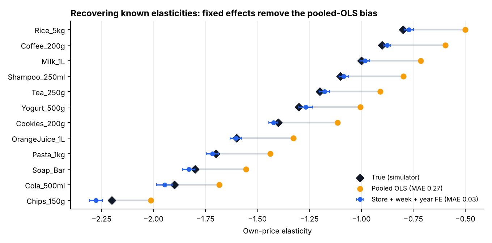
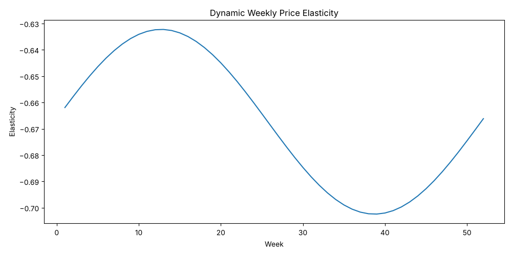
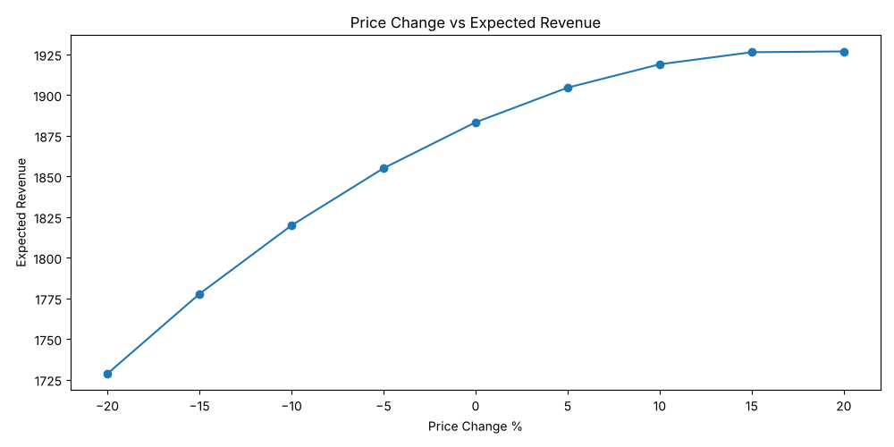
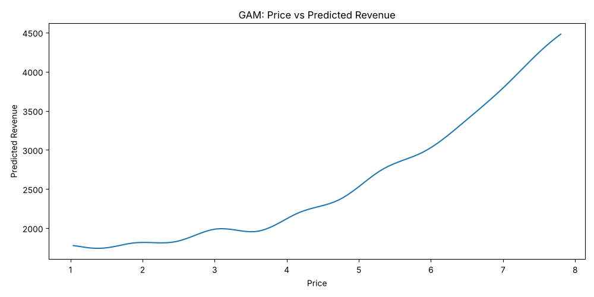
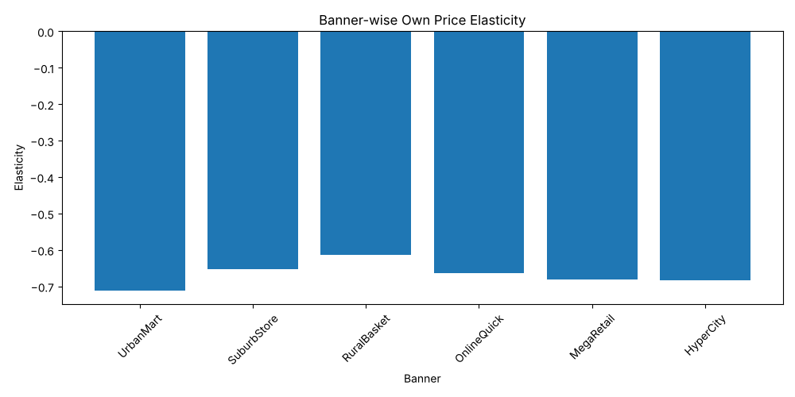

<div align="center">

# CPG Price Elasticity Lab

### Estimating own- and cross-price elasticities for retail pricing, and checking the estimates against known ground truth




</div>

---

## Why this repo exists

Revenue-growth-management teams price products using elasticities: how much volume moves when price moves. Real scan data never tells you the true elasticity, so a biased estimate goes unnoticed until it drives a bad pricing decision.

This lab uses a **synthetic panel where the true elasticities are known**: about 300,000 rows covering 12 SKUs, 20 stores, 6 banners and 208 weeks. That makes it possible to measure how well each modelling choice recovers the truth, instead of judging models by R².

## Key result

| Estimator (log-log, per product) | Own-price elasticity MAE vs truth | Cross-price elasticity (true 0.45) |
|---|---:|---:|
| Pooled OLS: `ln Q ~ ln P + ln P_comp + promo` | 0.271 | — |
| **Store + week + year fixed effects** | **0.028** | **0.465** |

Pooled OLS **underestimates price sensitivity for every SKU**, by about 0.3. Store-level demand differences and seasonality are confounded with price. Fixed effects absorb them and recover the true elasticities to within about 0.03.

**Why it matters.** The pipeline's price-scenario tool, run on the pooled elasticity (−0.74), says a **+10% price on Cola raises revenue by 1.9%**. With the recovered elasticity (about −1.9), the same move **cuts revenue by about 11%**. The biased estimate reverses the pricing decision.

## What the pipeline covers

`elasticity_pipeline.py` runs end to end:

1. **Data quality.** Missing-value audit and imputation (KNN and median), feature engineering (log price, discount depth, Fourier seasonality)
2. **EDA.** Sales by product and banner, weekly volume, correlation heatmap
3. **Multicollinearity.** A VIF check. Own and competitor prices have a VIF of about 29, which is why cross-price estimates need care
4. **Static log-log OLS.** Own and cross-price elasticity with a business interpretation
5. **Dynamic elasticity.** A price × seasonality interaction gives week-by-week elasticity
6. **Segment elasticities** by banner and by product
7. **Random Forest demand model** (R² 0.93) as a non-parametric benchmark
8. **GAM** price–quantity and price–revenue curves for revenue-optimal pricing
9. **Price-scenario simulation** from −20% to +20%

`validate_fixed_effects.py` benchmarks the estimators against the simulator's ground truth, producing the chart above.

| Weekly dynamic elasticity | Price-scenario revenue |
|---|---|
|  |  |
| **GAM price–revenue curve** | **Elasticity by banner** |
|  |  |

## Run

```bash
pip install -r requirements.txt
python elasticity_pipeline.py        # full pipeline, writes outputs/
python validate_fixed_effects.py     # ground-truth benchmark, writes docs/figures/elasticity_recovery.png
```

## Data

`data/cpg_weekly_store_sku.csv` is a **fully synthetic** weekly store × SKU panel (2022–2025) with fictional banners such as UrbanMart and HyperCity. It contains everyday and promotional prices, competitor prices, promotion flags, volume and revenue, and the generating elasticities (`elasticity_used`, `cross_price_elasticity`). It contains no real retailer or client data.

## Possible extensions

- Hierarchical (empirical Bayes) shrinkage of product × store elasticities toward the category mean
- Instrumenting price with cost shifters when promotions are endogenous
- Competitor-price composites (share-weighted) instead of a single competitor price

---

<div align="center">
<b>Sai Siddhanth</b> · B.Tech CSE (Data Science), VIT Vellore<br/>
<a href="https://www.linkedin.com/in/sai-siddhanth-67912628b">LinkedIn</a> · <a href="https://github.com/saisiddhanthks">GitHub</a>
</div>
